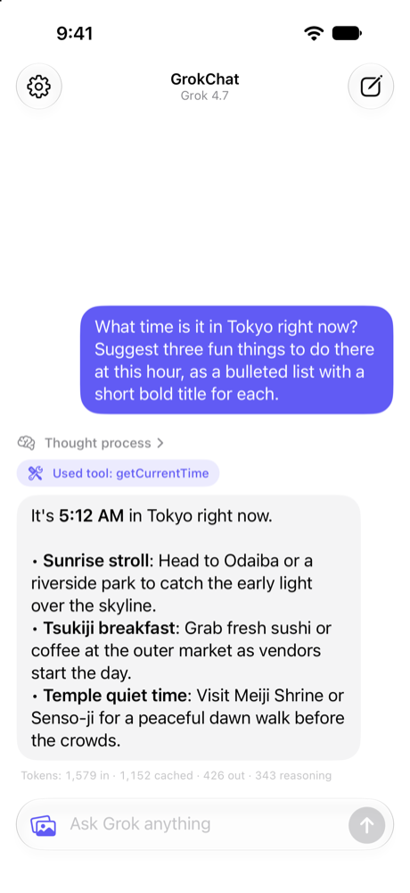

# GrokChat for iOS

A SwiftUI chat app that talks to SpaceXAI's Grok models, through the xAI API and Apple's Foundation Models framework, using the [GrokLanguageModel](../../README.md) package.

<p align="center">
  <picture>
    <source media="(prefers-color-scheme: dark)" srcset="Screenshots/chat-dark.png">
    
  </picture>
</p>

Everything in the app goes through a regular `LanguageModelSession`. The only Grok-specific code is picking a `GrokModel` and setting an API key:

```swift
let session = LanguageModelSession(model: GrokModel.grok4, tools: [CurrentTimeTool()], instructions: "…")
```

## What it shows

| Feature | How | Where |
| --- | --- | --- |
| Streaming replies | `session.streamResponse { … }` snapshots that grow the reply as the text streams in, with a stop button that cancels the task | `Conversation.swift`, `MessageView.swift` |
| Photo input | `PhotosPicker`, then `Attachment(cgImage)` in the prompt builder | `ComposerView.swift`, `Conversation.swift` |
| Reasoning | A collapsible **Thought process** built from `.reasoning` entries in `snapshot.transcriptEntries` | `ChatMessage.swift`, `MessageView.swift` |
| Tool calling | `CurrentTimeTool`, a `Tool` with `@Generable` arguments, plus **Used tool** chips from `.toolCalls` entries | `CurrentTimeTool.swift` |
| Token usage | Input, cached, output, and reasoning tokens from `snapshot.usage` | `MessageView.swift` |
| Models and effort | A picker built from `GrokModel.presets` and each model's `displayName`, and an effort picker built from its `supportedReasoningEfforts`, applied with `.reasoningEffort(_:)` | `ChatSettings.swift`, `SettingsView.swift` |
| Switching models mid-chat | A new session that starts from the old session's `transcript` | `Conversation.swift` |
| Errors | Banners for `GrokError` and `LanguageModelError`, with **Try Again** | `Conversation.swift`, `ChatView.swift` |
| API key storage | The Keychain, applied with `GrokConfiguration.default.apiKey`, and `apiKeySource` to show which key requests use | `KeychainStore.swift`, `ChatSettings.swift` |
| Markdown | Inline Markdown in replies with `AttributedString(markdown:)` | `MessageView.swift` |

## Requirements

- Xcode 27.1 or later
- An iOS 27 simulator or device
- An [xAI API key](https://console.x.ai)

## Run the app

1. Open `Examples/GrokChat-iOS/GrokChat.xcodeproj`.
2. Choose the **GrokChat** scheme and an iOS 27 simulator.
3. Press **Run**, then add your API key (see below).

The project depends on the package through a local package reference to the repository root (`../..`), so the app always builds against your checkout. To run on a device, select your own team under **Signing & Capabilities**.

To build from the command line:

```sh
xcodebuild -project Examples/GrokChat-iOS/GrokChat.xcodeproj \
  -scheme GrokChat \
  -destination 'generic/platform=iOS Simulator' \
  build
```

## Add your API key

**In the app.** Tap the gear button, paste your key, and tap **Save to Keychain**. GrokChat stores the key as a generic password (service `io.marcodotio.GrokChat`) and applies it when it launches:

```swift
GrokConfiguration.default.apiKey = KeychainStore.string(forAccount: "xai-api-key")
```

**With an environment variable.** When no key is saved, requests to the xAI API fall back to the `GROK_API_KEY` or `XAI_API_KEY` environment variable on their own, so you can set either one in the scheme while you develop. A saved key takes precedence. The package only reads these variables for xAI hosts, so if you point `GrokConfiguration.default.baseURL` at your own server, it never receives your development key.

Settings shows which key requests use, like **Using GROK_API_KEY from the environment**, from the package's `GrokConfiguration.default.apiKeySource`, without reading the key itself:

```swift
let status = switch GrokConfiguration.default.apiKeySource {
case .configuration: "Using the key saved in the Keychain"
case .environment(let variable): "Using \(variable) from the environment"
case nil: "No API key set"
}
```

> [!IMPORTANT]
> The GrokChat scheme is shared, and Xcode saves scheme environment variables in the scheme file. Duplicate the scheme and turn off **Shared** before you add your key, so that you don't commit it.

> [!WARNING]
> Don't ship an API key inside an app: anyone can extract it. In production, set `GrokConfiguration.default.baseURL` to your own server, which adds the key and forwards requests to the xAI API. The package doesn't require a key when `baseURL` isn't an xAI host, and doesn't send it one from the environment.

## Screenshots and UI tests

If the `demoPrompt` user default has a value when the app launches, GrokChat sends it once, automatically. Launch arguments like `-demoPrompt "…"` populate user defaults, so you can set it without changing any code:

- **Xcode:** The shared scheme includes a disabled `-demoPrompt "What time is it in Tokyo right now?"` argument. Turn it on under **Edit Scheme › Run › Arguments**.
- **simctl:** Pass the argument after the bundle identifier. `simctl` forwards environment variables that start with `SIMCTL_CHILD_` to the app, which is a handy way to supply a key:

  ```sh
  SIMCTL_CHILD_GROK_API_KEY="$GROK_API_KEY" \
    xcrun simctl launch booted io.marcodotio.GrokChat -demoPrompt "What time is it in Tokyo right now?"
  ```

- **Other settings:** Launch arguments override the saved settings too, without overwriting them. For example, add `-model grok-4.20-non-reasoning` for a quick first token, or `-model grok-4.3 -reasoningEffort none`.
- **XCUITest:**

  ```swift
  let app = XCUIApplication()
  app.launchArguments += ["-demoPrompt", "What time is it in Tokyo right now?"]
  app.launch()
  ```

## How it works

| File | Role |
| --- | --- |
| `GrokChatApp.swift` | Creates the settings and the conversation, and shares them through the environment. |
| `Conversation.swift` | Owns the `LanguageModelSession`, streams replies, and handles stopping, retrying, and errors. |
| `ChatMessage.swift` | The message model, updated from each `ResponseStream.Snapshot`. |
| `ChatSettings.swift` | The model, reasoning effort, tool, and API key settings. |
| `CurrentTimeTool.swift` | The tool that Grok calls to look up the date and time. |
| `KeychainStore.swift` | A small wrapper around `SecItem` generic passwords. |
| `ChatView.swift`, `MessageView.swift`, `ComposerView.swift`, `SettingsView.swift` | The SwiftUI interface. |

Each reply streams from a prompt that combines text and an optional photo:

```swift
let stream = session.streamResponse {
    text
    if let image {
        Attachment(image)
    }
}
for try await snapshot in stream {
    // snapshot.content is the text so far, snapshot.transcriptEntries has the
    // reasoning and tool calls, and snapshot.usage has the token counts.
}
```

A few details worth knowing:

- Snapshots arrive as the model generates text, so a reply grows word by word, and the chat scrolls with it. A **Thinking** placeholder shows until the first words arrive. The reasoning summary arrives with the first snapshot of text, so **Thought process** appears when the reply starts.
- The model picker and effort picker come from the package's `GrokModel.presets`, `displayName`, and `supportedReasoningEfforts`, so they stay in sync with the package. Settings stores the model's `name` and the effort's `rawValue` in `UserDefaults`, and resets the effort to the model's default when you pick a model that doesn't accept it.
- The project uses Swift 6 with `MainActor` default isolation, so `CurrentTimeTool` and its `@Generable` arguments are `nonisolated`, and `call(arguments:)` is `@concurrent`.
- Sessions use `transcriptErrorHandlingPolicy = .preserveTranscript`, so a stopped or failed prompt stays in the transcript, just as it stays on screen. **Try Again** removes the failed prompt from `session.transcript` before sending it again.
- Changing the model, reasoning effort, or tool in Settings takes effect with the next message. GrokChat creates a new session from the current transcript, so the conversation carries over. Grok's encrypted reasoning is only sent back to the model that produced it.

## Troubleshooting

- **"Add your xAI API key in Settings"** means that no key is saved and neither environment variable is set.
- **"A required entitlement is not present"** when you save a key means that the app was built without code signing (for example, with `CODE_SIGNING_ALLOWED=NO`), so it can't use the Keychain. Build normally, or use the environment variable instead.
- **HTTP 400 or 401 errors** usually mean that the key is invalid or was revoked. Replace it in Settings.
