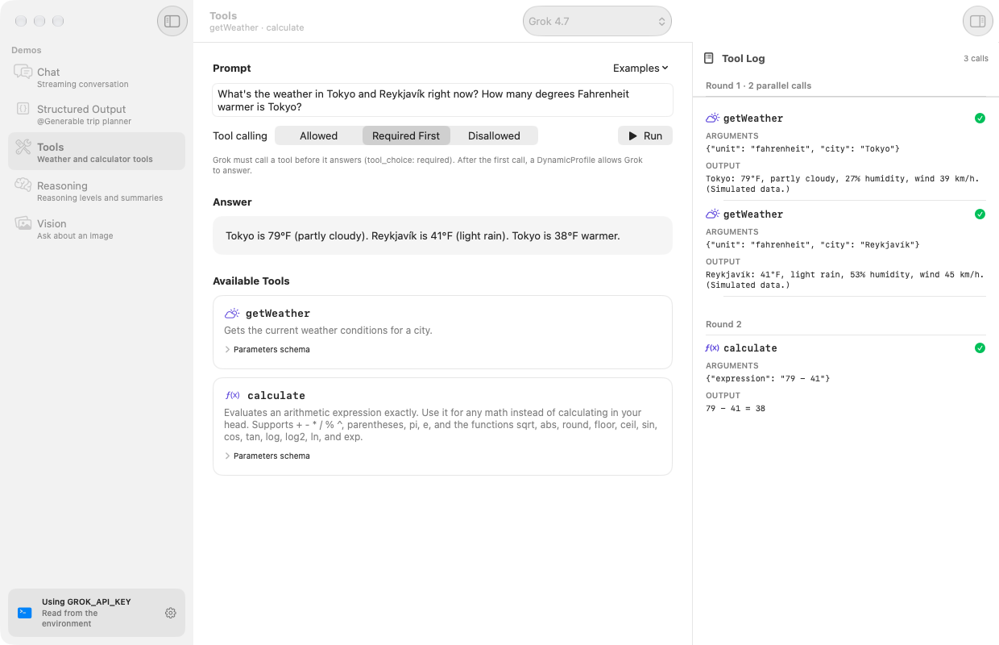

# GrokStudio for macOS

GrokStudio is a SwiftUI Mac app that shows off everything **GrokLanguageModel** can do. Each demo in the sidebar uses the standard Foundation Models API (`LanguageModelSession`, `@Generable`, `Tool`, `ContextOptions`, and `Attachment`) with a Grok model.

<p align="center">
  
</p>

| Demo | What it shows | Key APIs |
| --- | --- | --- |
| **Chat** | A streaming conversation with Markdown rendering, a stop button, and an inspector with the live transcript and cumulative token usage. Switching models mid-conversation keeps the history. | `streamResponse(to:)`, `session.transcript`, `session.usage`, `LanguageModelSession(model:transcript:)` |
| **Structured Output** | A `@Generable` `TripPlan` (days, activities, a packing list, and a budget with `@Guide` ranges) that renders field by field as it streams, plus the raw JSON. | `streamResponse(to:generating:)`, `PartiallyGenerated`, `@Guide(.range(_:))`, `@Guide(.count(_:))` |
| **Tools** | A mock `getWeather` tool and a real `calculate` tool, a live log of each call's arguments and output (read from the transcript), and a tool calling mode picker: **Allowed**, **Required First**, or **Disallowed**. | `Tool`, `@concurrent func call(arguments:)`, `GenerationOptions(toolCallingMode:)`, `LanguageModelSession(profile:)`, `@SessionPropertyEntry`, `.toolCalls` and `.toolOutput` entries |
| **Reasoning** | A hard question at a reasoning level of your choice, with the reasoning summary streaming in next to the answer, token counts, and a history table for comparing levels. The levels come from the selected model's supported reasoning efforts. | `ContextOptions(reasoningLevel:)`, `.custom("xhigh")`, `GrokModel.supportedReasoningEfforts`, `GrokModel.ReasoningEffort(_:)`, `.reasoning` entries, `usage.output.reasoningTokenCount` |
| **Vision** | Drop or choose an image (or use the built-in sample), then ask about it. | `session.respond { prompt; Attachment(image) }`, `fileImporter`, `dropDestination` |

A model picker in the toolbar applies to every demo, and a Settings window (**⌘,**) holds your API key and default model. Both pickers list `GrokModel.presets` by their `displayName`, so a preset that the package adds shows up without any changes to the app. Every demo can show its session's live transcript and token usage in an inspector.

<p align="center">
  
</p>

### Requiring a tool call

`GenerationOptions(toolCallingMode: .required)` requires a tool call on every request that a response makes, including the ones that follow each tool's output. Grok keeps calling tools and never writes a final answer, so the demo doesn't offer that mode as is. Its **Required First** mode follows the pattern that Apple documents for `ToolCallingMode.required` instead: a `LanguageModelSession.DynamicProfile` requires a tool call until the session makes one, then allows Grok to answer.

```swift
nonisolated extension SessionPropertyValues {
    @SessionPropertyEntry
    var toolCallCount: Int = 0
}

struct ToolFirstProfile: LanguageModelSession.DynamicProfile {
    var model: GrokModel
    var instructions: String
    var tools: [any Tool]

    @SessionProperty(\.toolCallCount)
    var toolCallCount

    var body: some DynamicProfile {
        Profile {
            Instructions(instructions)
            tools
        }
        .model(model)
        .toolCallingMode(toolCallCount < 1 ? .required : .allowed)
        .onToolCall {
            toolCallCount += 1
        }
    }
}

let session = LanguageModelSession(profile: ToolFirstProfile(model: .grok4, instructions: instructions, tools: tools))
```

GrokLanguageModel sends `tool_choice: "required"` on the first request and `"auto"` on the ones after the first tool call. **Allowed** and **Disallowed** pass `GenerationOptions(toolCallingMode:)` to a regular session. With **Allowed**, requests send `tool_choice: "auto"`, and with **Disallowed**, the session leaves the tools out of the request. Disallowed sessions start with instructions that don't mention the tools, because instructions that tell Grok to use tools it doesn't have lead it to write fake tool calls as its answer.

### Keyboard shortcuts

| Shortcut | Action |
| --- | --- |
| **Return** | Send the prompt from its text field |
| **⌘Return** | Run the Structured Output, Tools, Reasoning, or Vision demo from anywhere in it |
| **⌘.** | Stop the response in progress |
| **⌘N** | Start a new conversation in Chat |
| **⌃⌘I** | Show or hide the transcript inspector |
| **⌘,** | Open Settings |

## Requirements

- macOS 27
- Xcode 27.1 or later
- An [xAI API key](https://console.x.ai)

## Run it

1. Open `GrokStudio.xcodeproj` in Xcode. The project depends on the package at the root of this repository through a local package reference, so there's nothing to download.
2. Choose the **GrokStudio** scheme and your Mac, then press **⌘R**.
3. Add your API key in **GrokStudio > Settings…** (**⌘,**).

The project doesn't set a signing team, so Xcode signs the app to run on your Mac. To distribute it, choose your own team in the target's **Signing & Capabilities** tab.

## API keys

GrokStudio stores the key you paste in Settings in your Keychain (service `io.marcodotio.GrokStudio`) and applies it at launch and whenever it changes:

```swift
GrokConfiguration.default.apiKey = key
```

If no key is saved, requests to the xAI API fall back to the `GROK_API_KEY` or `XAI_API_KEY` environment variable. GrokLanguageModel only reads those variables for xAI hosts, so a key from your environment is never sent to another `baseURL`. The sidebar and Settings show where the key comes from with `GrokConfiguration.default.apiKeySource`, which never exposes the key itself. To use an environment variable while you develop, choose **Product > Scheme > Edit Scheme…**, select **Run > Arguments**, and add `GROK_API_KEY` under **Environment Variables**. The shared scheme doesn't include a value, so if you add one to it, don't commit it. Unchecking **Shared** on a duplicate of the scheme keeps it out of source control.

> [!IMPORTANT]
> An API key that ships inside an app can be extracted from it. In production, point `GrokConfiguration.default.baseURL` at your own server, which adds the key and forwards requests to the xAI API. Grok models don't require a key, or read one from the environment, when `baseURL` isn't an xAI host.

## Taking screenshots

Launch the app with a `-demoPrompt` argument, and the Chat demo sends it once at launch:

```bash
GROK_API_KEY=… GrokStudio.app/Contents/MacOS/GrokStudio -demoPrompt "Explain the Foundation Models framework in three bullet points."
```

The shared scheme includes this argument, turned off, under **Run > Arguments**.

To open a different demo at launch, pass `-demo` with `chat`, `structuredOutput`, `tools`, `reasoning`, or `vision`, like `-demo tools`. The Tools and Reasoning demos run a `-demoPrompt` as their prompt or question, and the Structured Output demo plans a trip to it as the destination. The Tools demo remembers its tool calling mode, which `-toolCallingMode` can set to `allowed`, `requiredFirst`, or `disallowed`:

```bash
GrokStudio.app/Contents/MacOS/GrokStudio -demo tools -toolCallingMode requiredFirst -demoPrompt "What's the weather in Tokyo and Reykjavík right now? How many degrees Fahrenheit warmer is Tokyo?"
```

## How it's built

- **Concurrency:** The target isolates code to the main actor by default (`SWIFT_DEFAULT_ACTOR_ISOLATION = MainActor`) and uses approachable concurrency. Tools, `@Generable` types, and the `toolCallCount` session property are `nonisolated`, and each tool's `call(arguments:)` is `@concurrent`, because sessions call tools, read session properties, and decode generated content off the main actor.
- **Streaming:** Chat, Structured Output, Tools, and Reasoning iterate `streamResponse`, and GrokLanguageModel publishes a snapshot as text arrives, so replies and trip plans render as Grok writes them.
- **Observation:** `LanguageModelSession` is observable, so the transcript inspector, the tool log, and the reasoning summary read `session.transcript` and `session.usage` directly and update while a response streams. The reasoning summary streams in from the transcript's `.reasoning` entries before the answer starts. The session updates them off the main actor, so each view also redraws when its response ends, to show the final values.
- **Cancellation:** Stopping a response cancels the task that iterates the stream. Each demo ignores output from a canceled task, so a stopped run never overwrites the run that replaced it. The Chat demo's sessions use `transcriptErrorHandlingPolicy = .preserveTranscript`, so a stopped or failed prompt stays in the transcript, just as it stays on screen.
- **Errors:** `PresentableError` turns `GrokError` (like a missing key or a rejected request) and `LanguageModelError` (like rate limits, timeouts, and content filter stops) into banners, with a shortcut to Settings when a setting can fix the problem.
- **Sandbox:** The app runs in the App Sandbox with outgoing network connections and read-only access to files you choose.

| Folder | Contents |
| --- | --- |
| `App` | The app, the sidebar, Settings, the Keychain store, and descriptions of the package's model presets |
| `Chat` | The chat model, the chat view, and message rows |
| `StructuredOutput` | The `@Generable` trip plan types and the planner |
| `Tools` | The weather and calculator tools, the expression evaluator, the tool log, and the dynamic profile that requires a tool call first |
| `Reasoning` | The reasoning demo |
| `Vision` | The image demo and its sample image |
| `Shared` | The transcript inspector, Markdown rendering, the prompt composer, usage views, and error presentation |
