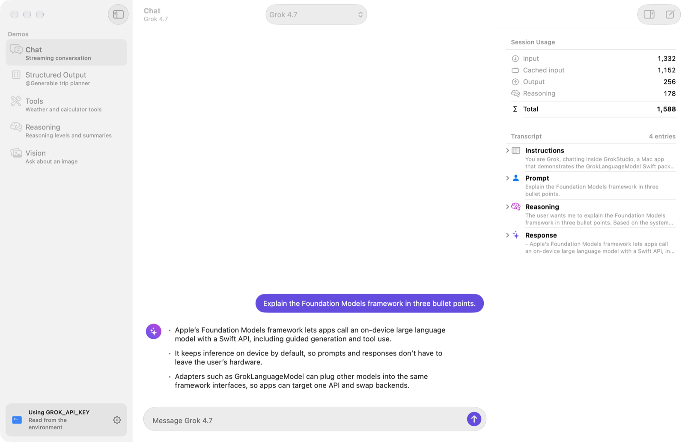
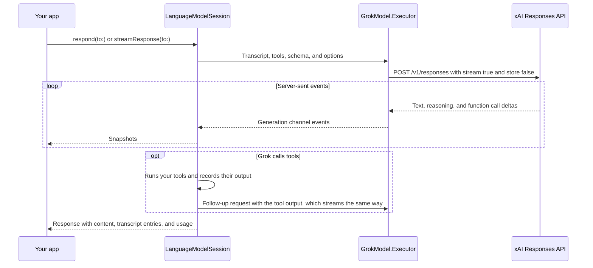

<div align="center">

# GrokLanguageModel

**Grok models for Apple's Foundation Models framework**

[](https://github.com/MarcoDotIO/GrokLanguageModel/actions/workflows/ci.yml)
[](#requirements)
[](#requirements)
[](#installation)
[](https://github.com/MarcoDotIO/GrokLanguageModel/releases/latest)
[](LICENSE)

[Installation](#installation) · [Quick start](#quick-start) · [Models](#models) · [Usage](#usage) · [How it works](#how-it-works) · [Example apps](#example-apps)

<br>

<a href="Examples/GrokChat-iOS"><picture><source media="(prefers-color-scheme: dark)" srcset="Examples/GrokChat-iOS/Screenshots/chat-dark.png"></picture></a>
&nbsp;&nbsp;
<a href="Examples/GrokStudio-macOS"></a>

</div>

GrokLanguageModel lets you use SpaceXAI's Grok models, through the xAI API, anywhere you'd use Apple's on-device model. `GrokModel` conforms to the Foundation Models `LanguageModel` protocol, so you create a `LanguageModelSession` with it and keep using the API you already know: streaming, `@Generable` structured output, tools, reasoning, and image attachments.

```swift
import FoundationModels
import GrokLanguageModel

GrokConfiguration.default.apiKey = "<your xAI API key>"

let session = LanguageModelSession(model: GrokModel.grok4)
let response = try await session.respond(to: "What makes a great Swift API?")
print(response.content)
```

## Highlights

| Feature | What you get |
| --- | --- |
| **Drop-in `LanguageModel`** | Create a `LanguageModelSession` with a `GrokModel`. Prompts, instructions, transcripts, and usage work the same way they do with the system model. |
| **Streaming** | Responses stream from the xAI Responses API over server-sent events, so snapshots update as the text arrives. |
| **Guided generation** | `@Generable` types and `GenerationSchema`s become strict JSON schemas, including streamed `PartiallyGenerated` snapshots. |
| **Tool calling** | Your `Tool` types run automatically, including several calls in a single turn. |
| **Reasoning** | Set a reasoning effort per model or per request, read reasoning summaries from the transcript, and keep Grok's encrypted reasoning across turns. |
| **Vision** | Attach a `CGImage`, `CIImage`, `CVPixelBuffer`, or image file with `Attachment`. |
| **Model presets** | `GrokModel.presets` lists every Grok model preset with its display name and the reasoning efforts it accepts, ready for a model picker. |
| **Familiar errors** | Rate limits, timeouts, and content-filter stops surface as `LanguageModelError`. Other API failures throw a descriptive `GrokError`. |
| **Private by default** | Requests ask xAI not to store conversations, and API keys are redacted from descriptions and debugger output. |
| **Proxy-ready** | Point `baseURL` at your own server to keep your xAI key off users' devices. Keys from environment variables only ever go to xAI. |
| **Swift 6 native** | `Sendable` throughout, strict concurrency, and no dependencies beyond Apple's frameworks. |

## Requirements

| | Minimum |
| --- | --- |
| Platforms | iOS 27.0, macOS 27.0, visionOS 27.0 |
| Toolchain | Xcode 27.1 or later |
| Account | An API key from the [xAI Console](https://console.x.ai) |

## Installation

### Xcode

1. Choose **File › Add Package Dependencies…**
2. Enter `https://github.com/MarcoDotIO/GrokLanguageModel`.
3. Choose **Up to Next Major Version** starting at `1.0.0`, then add the **GrokLanguageModel** library to your app target.

### Swift Package Manager

Add the package to the dependencies in your `Package.swift`:

```swift
// swift-tools-version: 6.2
import PackageDescription

let package = Package(
    name: "MyApp",
    platforms: [.iOS("27.0"), .macOS("27.0"), .visionOS("27.0")],
    dependencies: [
        .package(url: "https://github.com/MarcoDotIO/GrokLanguageModel.git", from: "1.0.0"),
    ],
    targets: [
        .target(
            name: "MyApp",
            dependencies: [
                .product(name: "GrokLanguageModel", package: "GrokLanguageModel"),
            ]
        ),
    ]
)
```

## Quick start

### 1. Provide an API key

Set a key once, before you create sessions, and every Grok model that doesn't have its own configuration uses it:

```swift
GrokConfiguration.default.apiKey = "<your xAI API key>"
```

Or give a single model its own key:

```swift
let model = GrokModel.grok4.apiKey("<your xAI API key>")
```

The model copies `GrokConfiguration.default` when you call `apiKey(_:)`, so later changes to the default configuration don't apply to it.

If no key is configured, requests to the xAI API fall back to the `GROK_API_KEY` environment variable, then `XAI_API_KEY`. During development, add one of them to your scheme under **Product › Scheme › Edit Scheme… › Run › Arguments › Environment Variables** and skip the code entirely. Xcode saves a shared scheme's environment variables in the scheme file, which you commit with your project, so add the key to a scheme that isn't shared: turn off **Shared** for it in **Product › Scheme › Manage Schemes…**. The package only reads these variables for requests to xAI, never for [your own server](#use-your-own-server).

To show which key requests use without reading the key itself, such as in your app's settings, check `apiKeySource`:

```swift
let keyStatus = switch GrokConfiguration.default.apiKeySource {
case .configuration: "Using the key you entered"
case .environment(let variable): "Using \(variable) from the environment"
case nil: "No API key"
}
```

> [!IMPORTANT]
> Anyone can extract an API key that ships inside an app. Before you ship, read [Security](#security) and consider routing requests through [your own server](#use-your-own-server).

### 2. Start a session

```swift
import FoundationModels
import GrokLanguageModel

let session = LanguageModelSession(
    model: GrokModel.grok4,
    instructions: "You're a concise assistant for iOS developers."
)

let response = try await session.respond(to: "When should I use an actor instead of a class?")
print(response.content)
print("Tokens used: \(response.usage.totalTokenCount)")
```

That's it. The rest of this guide covers choosing a model and the Foundation Models features that Grok supports.

## Models

| Preset | Display name | API model | Context window | Reasoning efforts |
| --- | --- | --- | --- | --- |
| `.grok4_7` (also `.grok4`) | Grok 4.7 | `grok-4.7` | 500K | `.low`, `.medium`, `.high`, `.xhigh` |
| `.grok4_6` | Grok 4.6 | `grok-4.6` | 500K | `.low`, `.medium`, `.high`, `.xhigh` |
| `.grok4_5` | Grok 4.5 | `grok-4.5` | 500K | `.low`, `.medium`, `.high` |
| `.grok4_3` | Grok 4.3 | `grok-4.3` | 1M | `.disabled`, `.low`, `.medium`, `.high` |
| `.grok4_20` | Grok 4.20 | `grok-4.20-reasoning` | 1M | Not adjustable |
| `.grok4_20NonReasoning` | Grok 4.20 Non-Reasoning | `grok-4.20-non-reasoning` | 1M | None (doesn't reason) |
| `.grokBuild` | Grok Build | `grok-build-0.1` | 256K | Not adjustable |

- `.grok4` always refers to the most capable Grok 4 model, currently Grok 4.7. Use a versioned preset to pin a model.
- `.grok4_3` is fast, has a 1M-token context window, and is the only preset that can turn reasoning off.
- `.grokBuild` pins `grok-build-0.1`, a model tuned for agentic coding that replaced `grok-code-fast-1`. Unlike xAI's `grok-build-latest` alias, which can point to a different model, it always uses `grok-build-0.1`.
- Every preset supports image input, guided generation, and tool calling.
- When you don't set an effort, xAI uses the model's default.

### Show a model picker

`GrokModel.presets` lists every preset once, in an order that suits a model picker. It leaves out `.grok4`, which is the same model as `.grok4_7`. Each model's `displayName` is a name to show people, and its `supportedReasoningEfforts` lists the efforts it accepts, from least to most:

```swift
import GrokLanguageModel
import SwiftUI

struct ModelPicker: View {
    @Binding var model: GrokModel

    var body: some View {
        Picker("Model", selection: $model) {
            ForEach(GrokModel.presets, id: \.self) { preset in
                Text(preset.displayName).tag(preset)
            }
        }
    }
}
```

Offer reasoning efforts the same way, from the selected model's `supportedReasoningEfforts`, and hide that picker when `supportsReasoningEffort` is `false`. `GrokModel` equality compares every property, including `reasoningEffort` and `configuration`, so keep the selection a plain preset and apply modifiers like `reasoningEffort(_:)` when you create the session.

### Use another model

To use a model that doesn't have a preset yet, create it by name. By default, a custom model shows its API name as its display name, has a 256K-token context window, supports image input, guided generation, tool calling, and reasoning, and accepts the `.low`, `.medium`, and `.high` efforts. Pass `displayName`, `contextSize`, `capabilities`, and `supportedReasoningEfforts` to change that:

```swift
let model = GrokModel(
    name: "grok-4.8",
    displayName: "Grok 4.8",
    contextSize: 500_000,
    supportedReasoningEfforts: [.low, .medium, .high, .xhigh]
)
```

For a model that reasons but doesn't accept an effort, pass an empty array of efforts. A model whose `capabilities` don't include `.reasoning` accepts no efforts by default, and its requests never include one.

## Usage

### Stream responses

Each snapshot contains the full response so far:

```swift
let stream = session.streamResponse(to: "Write a haiku about the Swift compiler.")

for try await snapshot in stream {
    print(snapshot.content)
}
```

A new snapshot arrives as each part of the answer does. When Grok reasons before it answers, no snapshot arrives until the answer starts. Show a progress indicator until then, or show Grok's reasoning summary as it streams: the session is observable, and it adds a `.reasoning` entry to `session.transcript` and updates it while Grok thinks.

In SwiftUI, assign each snapshot to state and the text fills in as Grok writes:

```swift
import FoundationModels
import GrokLanguageModel
import SwiftUI

struct HaikuView: View {
    @State private var session = LanguageModelSession(model: GrokModel.grok4_3)
    @State private var haiku = ""

    var body: some View {
        Text(haiku)
            .task {
                do {
                    for try await snapshot in session.streamResponse(to: "Write a haiku about Mars.") {
                        haiku = snapshot.content
                    }
                } catch {
                    haiku = error.localizedDescription
                }
            }
    }
}
```

SwiftUI cancels the `.task` when the view disappears. To stop a response yourself, like when someone taps a Stop button, cancel the task that iterates the stream. The loop ends without throwing an error, and the last snapshot you received holds the response so far:

```swift
let task = Task {
    for try await snapshot in session.streamResponse(to: "Tell me a long story about Mars.") {
        print(snapshot.content)
    }
}

// Later, when someone taps Stop:
task.cancel()
```

### Generate structured output

Describe the output you want with `@Generable`, and Grok fills it in. The package sends your type's schema as a strict JSON schema, so the response matches your type.

```swift
@Generable
struct Itinerary {
    @Guide(description: "A short, catchy title for the trip")
    var title: String

    @Guide(description: "A plan for each day of the trip", .count(1...7))
    var days: [DayPlan]
}

@Generable
struct DayPlan {
    @Guide(description: "The city to spend the day in")
    var city: String

    @Guide(description: "Things to do that day", .count(2...4))
    var activities: [String]
}

let itinerary = try await session.respond(
    to: "Plan a three-day trip to Japan.",
    generating: Itinerary.self
).content
print(itinerary.title)
```

Stream the same type to show results as they arrive. Each snapshot is an `Itinerary.PartiallyGenerated`, whose properties are optional until Grok generates them. Grok generates properties in the order that your type declares them, so `title` fills in before `days`:

```swift
let stream = session.streamResponse(to: "Plan a three-day trip to Japan.", generating: Itinerary.self)

for try await snapshot in stream {
    let partial = snapshot.content
    print(partial.title ?? "…", "with", partial.days?.count ?? 0, "days so far")
}
```

### Call tools

Give the session your tools, and it runs them whenever Grok asks. Grok can make several tool calls in one turn, like checking the weather in two cities at once.

```swift
struct WeatherTool: Tool {
    let name = "getWeather"
    let description = "Gets the current weather for a city."

    @Generable
    struct Arguments {
        @Guide(description: "The name of the city")
        var city: String
    }

    @concurrent func call(arguments: Arguments) async throws -> String {
        // Look up the weather with your own service.
        "It's 23°C and sunny in \(arguments.city)."
    }
}

let session = LanguageModelSession(
    model: GrokModel.grok4,
    tools: [WeatherTool()],
    instructions: "Use the getWeather tool to answer questions about the weather."
)

let response = try await session.respond(to: "Should I pack an umbrella for Paris or for Rome?")
```

#### Require or prevent tool calls

To require a tool call, or to prevent one, set a tool calling mode:

```swift
let options = GenerationOptions(toolCallingMode: .required)
let response = try await session.respond(to: "What's the weather in Tokyo?", options: options)
```

`.required` follows Foundation Models semantics: the session requires a tool call in every request of the turn, including the follow-up requests that carry tool output, so Grok keeps calling tools until one of them throws an error or a dynamic profile changes the mode. To require just one call, count tool calls in a `LanguageModelSession.DynamicProfile` and allow Grok to answer after the first:

```swift
extension SessionPropertyValues {
    @SessionPropertyEntry
    var toolCallCount: Int = 0
}

struct WeatherProfile: LanguageModelSession.DynamicProfile {
    @SessionProperty(\.toolCallCount)
    var toolCallCount

    var body: some LanguageModelSession.DynamicProfile {
        Profile {
            Instructions("Use the getWeather tool to answer questions about the weather.")
            WeatherTool()
        }
        .model(GrokModel.grok4)
        .toolCallingMode(toolCallCount < 1 ? .required : .allowed)
        .onToolCall {
            toolCallCount += 1
        }
    }
}

let session = LanguageModelSession(profile: WeatherProfile())
let response = try await session.respond(to: "What's the weather in Tokyo?")
```

The count lasts for the whole session. To require a tool call again for a later prompt, reset it first with `session.properties.toolCallCount = 0`.

#### Inspect tool calls

The session records each call and its output in its transcript:

```swift
for entry in session.transcript {
    if case .toolCalls(let calls) = entry {
        for call in calls {
            print("Grok called \(call.toolName) with \(call.arguments.jsonString)")
        }
    }
}
```

### Control reasoning

Most Grok models reason before they answer. Set a default reasoning effort on the model, and override it for individual requests with `ContextOptions`:

```swift
let session = LanguageModelSession(model: GrokModel.grok4.reasoningEffort(.low))

let response = try await session.respond(
    to: "How many weekdays are there between March 3 and April 18, 2027?",
    contextOptions: ContextOptions(reasoningLevel: .deep)
)
print("Reasoning tokens: \(response.usage.output.reasoningTokenCount)")
```

#### Read reasoning summaries

When Grok returns a summary of its reasoning, the session records it as a reasoning entry in the transcript:

```swift
for entry in response.transcriptEntries {
    if case .reasoning(let reasoning) = entry {
        for case .text(let text) in reasoning.segments {
            print("Grok thought: \(text.content)")
        }
    }
}
```

#### Map reasoning levels to efforts

A request's `ContextOptions.reasoningLevel` takes precedence over the model's `reasoningEffort`, which takes precedence over xAI's default for the model:

| `ContextOptions.ReasoningLevel` | `GrokModel.ReasoningEffort` | Sent to xAI as |
| --- | --- | --- |
| `.light` | `.low` | `low` |
| `.moderate` | `.medium` | `medium` |
| `.deep` | `.high` | `high` |
| `.custom("xhigh")` | `.xhigh` | `xhigh` |
| `.custom("none")` | `.disabled` | `none` |

#### Check supported efforts

Each model accepts a different set of efforts, which its `supportedReasoningEfforts` lists; see [Models](#models). The package sends the effort you choose as is, without checking it against that list, so only offer efforts the model accepts. The xAI API rejects some unsupported efforts, and treats `xhigh` as `high` on models before Grok 4.6. `GrokModel.ReasoningEffort(_:)` converts a reasoning level with the same mapping that the package uses:

```swift
let model = GrokModel.grok4_5
let level = ContextOptions.ReasoningLevel.custom("xhigh")

if model.supportedReasoningEfforts.contains(GrokModel.ReasoningEffort(level)) {
    // Grok 4.5 doesn't support xhigh, so this doesn't run.
}
```

`supportsReasoningEffort` is `false` for models that don't reason or whose `supportedReasoningEfforts` is empty. They don't accept an effort, and the package leaves both settings out of their requests.

#### Keep reasoning across turns

Grok also returns its reasoning in encrypted form. The package keeps it in the transcript and sends it back with later requests to the same model, so Grok keeps its train of thought across turns and tool calls.

### Attach images

Add images to a prompt with `Attachment`, which accepts a `CGImage`, `CIImage`, `CVPixelBuffer`, or the URL of an image file:

```swift
let photo: CGImage = try loadPhoto() // Your own image loading code.

let response = try await session.respond {
    "What's in this photo? Answer in one sentence."
    Attachment(photo)
}
```

Label attachments when a prompt refers to more than one:

```swift
let response = try await session.respond {
    "Which receipt has the higher total, the first or the second?"
    Attachment(imageURL: firstReceiptURL).label("first")
    Attachment(imageURL: secondReceiptURL).label("second")
}
```

Local JPEG and PNG files are sent as they are, unless you give the attachment an orientation other than `.up`, and remote `http` and `https` image URLs are sent as URLs. Other images are encoded as PNG if they have transparency, or as JPEG otherwise.

### Have a conversation

A session remembers the conversation, so follow-up prompts have context:

```swift
let session = LanguageModelSession(model: GrokModel.grok4_3)

try await session.respond(to: "I'm Ada, and I'm learning SwiftUI.")
let reply = try await session.respond(to: "Suggest a first project for me, and use my name.")
print(reply.content)
```

Transcripts are `Codable`, so you can save a conversation and pick it up later, even with a different Grok model:

```swift
let data = try JSONEncoder().encode(session.transcript)

// Later…
let transcript = try JSONDecoder().decode(Transcript.self, from: data)
let resumed = LanguageModelSession(model: GrokModel.grok4, transcript: transcript)
```

When you switch models, the package leaves out encrypted reasoning from the previous model, which only the model that produced it can read.

### Tune generation

Pass `GenerationOptions` to control sampling and response length:

```swift
let options = GenerationOptions(
    samplingMode: .random(probabilityThreshold: 0.9),
    temperature: 0.7,
    maximumResponseTokens: 2_000
)

let response = try await session.respond(to: "Name a Swift feature you'd like to see.", options: options)
```

The package translates each Foundation Models setting to its Responses API equivalent:

| Foundation Models | xAI Responses API |
| --- | --- |
| `GenerationOptions.temperature` | `temperature` |
| `GenerationOptions.maximumResponseTokens` | `max_output_tokens`, which includes reasoning tokens |
| `SamplingMode.greedy` | `top_k: 1` |
| `SamplingMode.random(top:)` | `top_k` |
| `SamplingMode.random(probabilityThreshold:)` | `top_p` |
| `GenerationOptions.toolCallingMode`: `.allowed`, `.required` | `tool_choice`: `auto`, `required`, when the session has tools. With `.disallowed`, the session leaves its tools out of the request, so neither `tools` nor `tool_choice` is sent. |
| `ContextOptions.reasoningLevel` | `reasoning.effort` |
| `@Generable` types and `GenerationSchema` | `text.format`, a strict `json_schema` |

The xAI API doesn't support sampling seeds, so the package ignores them.

### Handle errors

Grok models throw the same `LanguageModelError` cases as the system model where one fits, and a `GrokError` otherwise:

```swift
do {
    let response = try await session.respond(to: "Summarize today's Swift news.")
    print(response.content)
} catch GrokError.missingAPIKey {
    print("Add an xAI API key in Settings.")
} catch GrokError.requestFailed(let statusCode, let code, let message) {
    print("xAI rejected the request (HTTP \(statusCode), \(code ?? "no code")): \(message)")
} catch GrokError.generationFailed(_, let message) {
    print("Grok stopped partway through: \(message)")
} catch LanguageModelError.rateLimited(let rateLimit) {
    print("Rate limited. Try again after \(rateLimit.resetDate?.formatted() ?? "a short wait").")
} catch LanguageModelError.timeout {
    print("The request timed out.")
} catch LanguageModelError.guardrailViolation {
    print("xAI's content filter stopped the response.")
} catch {
    print(error.localizedDescription)
}
```

| Error | When |
| --- | --- |
| `GrokError.missingAPIKey` | A request to the xAI API has no API key. |
| `GrokError.requestFailed(statusCode:code:message:)` | The xAI API rejected the request, like for an invalid key or model name. |
| `GrokError.generationFailed(code:message:)` | The model failed while it streamed a response. |
| `GrokError.invalidResponse(_:)` | The server sent a response the package couldn't understand, or the stream ended before the response completed. |
| `GrokError.imageEncodingFailed` | An image attachment couldn't be encoded as JPEG or PNG. |
| `LanguageModelError.rateLimited(_:)` | The xAI API responded with HTTP 429. `resetDate` comes from the `Retry-After` header when it gives a number of seconds. |
| `LanguageModelError.timeout(_:)` | No data arrived within the configuration's `timeoutInterval`. |
| `LanguageModelError.guardrailViolation(_:)` | xAI's content filter stopped the response. |
| `URLError` | The connection failed for another reason, like when the device is offline. |

`GrokError` conforms to `LocalizedError`, so `localizedDescription` gives you a readable message. Its cases don't change within a major version, so a `switch` that handles each of them keeps compiling when you update to a later 1.x release.

A request whose conversation doesn't fit in the model's context window fails with `GrokError.requestFailed`. The package doesn't throw `LanguageModelError.contextSizeExceeded`, and a model's `contextSize` is for your information only.

### Use your own server

For production apps, keep your xAI key on a server you control. Point `baseURL` at it, and the package sends requests to the `responses` endpoint relative to that URL. When `baseURL` isn't an xAI host, the package doesn't require an API key, and it never reads the `GROK_API_KEY` or `XAI_API_KEY` environment variable, so a key from your development environment can't reach your server. Authenticate users however you like, such as with a token from your own sign-in flow:

```swift
GrokConfiguration.default = GrokConfiguration(
    baseURL: URL(string: "https://api.example.com/grok/v1")!,
    additionalHeaders: ["Authorization": "Bearer \(userSessionToken)"],
    timeoutInterval: 120
)
```

Your server adds the xAI key, forwards the request body unchanged to `https://api.x.ai/v1/responses`, and streams the server-sent events back.

To route only some models through your server, give them their own configuration, which they use instead of `GrokConfiguration.default`:

```swift
var model = GrokModel.grok4_3
model.configuration = GrokConfiguration(
    baseURL: URL(string: "https://api.example.com/grok/v1")!,
    timeoutInterval: 60
)
```

## How it works



- **Stateless requests.** The session owns the transcript, so each request sends the whole conversation with `store: false`, which asks xAI not to keep it.
- **Prompt caching.** Every request in a session uses the ID of the transcript's first entry as its `prompt_cache_key`, which routes the session's requests to the same prompt cache. Cached tokens show up in `response.usage.input.cachedTokenCount`.
- **Encrypted reasoning.** Each reasoning entry's signature holds Grok's encrypted reasoning along with the name of the model that produced it, and the package only sends it back to that model.
- **Declaration order.** Grok generates a JSON schema's properties in the order that the request lists them, so the package lists each schema's properties in the order that your `@Generable` type declares them. Structured output and tool arguments generate in that order, and streamed snapshots fill in from the first property down.

<details>
<summary>How transcript entries map to Responses API input</summary>

| Transcript entry | Responses API input item |
| --- | --- |
| `.instructions` | A `system` message. Images move to a `user` message, because the API ignores images in system messages. |
| `.prompt` | A `user` message with text and `input_image` parts. |
| `.response` | An `assistant` message. Structured content is sent as JSON. |
| `.reasoning` | A `reasoning` item with the summary and `encrypted_content`, for the same model only. |
| `.toolCalls` | One `function_call` item per call. |
| `.toolOutput` | A `function_call_output` item. |

</details>

## Example apps

The [`Examples`](Examples) folder has two SwiftUI apps that use the package from this repository through a local package reference, so they always build against your checkout.

| App | Platform | What it shows |
| --- | --- | --- |
| [GrokChat](Examples/GrokChat-iOS) | iOS 27 | A chat app that streams Grok's replies, with photo attachments, a model and reasoning effort picker, and an optional current-time tool. |
| [GrokStudio](Examples/GrokStudio-macOS) | macOS 27 | A sidebar of feature demos: streaming chat, `@Generable` structured output, tool calling, reasoning levels and summaries, and image input. |

<p align="center">
  <a href="Examples/GrokChat-iOS"></a>
  &nbsp;
  <a href="Examples/GrokStudio-macOS"></a>
</p>

```bash
open Examples/GrokChat-iOS/GrokChat.xcodeproj
open Examples/GrokStudio-macOS/GrokStudio.xcodeproj
```

Run the **GrokChat** or **GrokStudio** scheme, then paste your API key into the app, which stores it in the Keychain. Alternatively, set `GROK_API_KEY` in the environment variables of a copy of the scheme with **Shared** turned off. The example schemes are shared and committed, so never add a key to them. Each app's README has more details.

## Documentation

The package includes a DocC catalog. In Xcode, choose **Product › Build Documentation** to browse it alongside the Foundation Models documentation.

## Testing

```bash
# All tests. Live tests run only when an API key is available.
swift test

# Offline tests only, against a mock server.
swift test --skip GrokLanguageModelTests.GrokLanguageModelTests/

# Live tests only, against the xAI API.
swift test --filter GrokLanguageModelTests.GrokLanguageModelTests/
```

The offline tests use a mock server and never touch the network. The live tests make a few small requests to the xAI API and need an API key. See [CONTRIBUTING.md](CONTRIBUTING.md#running-the-tests) for how to provide one and how CI runs the tests.

## Security

- **Don't ship your key.** Anyone can extract an API key that's embedded in an app. For production, [use your own server](#use-your-own-server) that authenticates your users and adds the key.
- **Store user-provided keys in the Keychain**, like the example apps do, rather than in `UserDefaults` or files.
- **Environment keys only go to xAI.** The package reads `GROK_API_KEY` and `XAI_API_KEY` only for requests to an xAI host, `x.ai` or one of its subdomains, over `https`, so a custom `baseURL` never receives a key from the environment, and it's never sent in cleartext.
- **Only send `apiKey` to servers you trust.** The package sends a key that you set in `apiKey` to whatever `baseURL` you set, so only combine the two for servers you control, over `https`.
- **Keys stay out of logs.** `GrokConfiguration`'s `description`, `debugDescription`, and mirror redact the API key, header values, and any credentials in `baseURL`, and the package never logs requests.

To report a vulnerability, see [SECURITY.md](SECURITY.md).

## Contributing

Contributions are welcome. Read [CONTRIBUTING.md](CONTRIBUTING.md) to set up the project, run the tests, and open a pull request, and see [CHANGELOG.md](CHANGELOG.md) for what's changed in each release.

## License

GrokLanguageModel is available under the MIT license. See [LICENSE](LICENSE) for details.

<sub>GrokLanguageModel is an independent open-source project. It isn't affiliated with or endorsed by SpaceXAI, xAI, or Apple. Grok is a trademark of its owner. Apple and Foundation Models are trademarks of Apple Inc.</sub>
